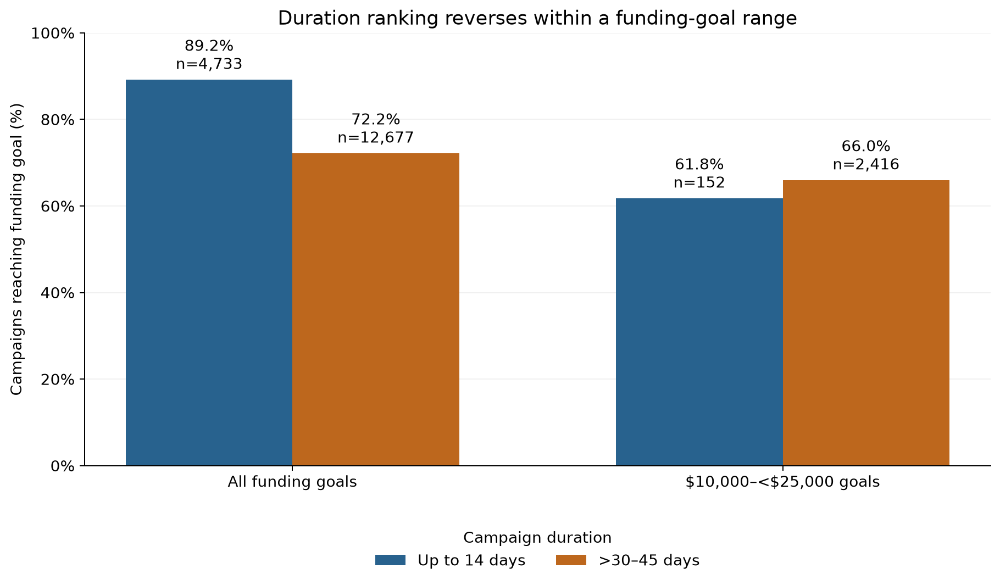

# Kickstarter campaign outcomes: a founder’s launch-plan benchmark

DATA3125 individual project by Gechleng Lim. Can past Kickstarter campaigns
help a founder benchmark a new launch plan and anticipate whether it will
reach its funding goal?

The analysis uses **63,075 unique campaigns launched in 2024–2026**, observed
in ten [Web Robots Kickstarter snapshots](https://webrobots.io/kickstarter-datasets/)
from January–October 2026. It combines descriptive comparisons with a small,
reproducible five-input prediction demo inside a notebook.

## Research questions

1. How do success rates differ by category and country?
2. How are funding goal and duration associated with success?
3. How do success rates vary by launch month and year?
4. Can goal, duration, launch month, main category, and country predict funding success?

## Findings

- Category and market matter for choosing comparable campaigns: Comics has
  **93.1%** observed success versus **84.4%** for Games; the US has **70.3%**
  across 33,948 campaigns, while Hong Kong has **90.6%** across 2,773.
- Campaigns seeking under $1,000 succeed **89.3%** of the time, versus **27.7%**
  for goals of $50,000 or more. These are observed associations, not causal effects.
- The duration ranking reverses after restricting the funding range:

  | Cohort | Up to 14 days | Over 30 through 45 days |
  | --- | ---: | ---: |
  | All funding goals | 89.2% (n=4,733) | 72.2% (n=12,677) |
  | $10,000–<$25,000 goals | 61.8% (n=152) | 66.0% (n=2,416) |

  The narrow short-duration group is much smaller. This does **not** establish
  that extending a campaign improves its odds.
- September 2026's **95.0%** rate covers only **338 eligible campaigns**.
  The October 1 deadline/outcome cutoff excludes later-finishing campaigns,
  so this is not the full month's success rate.



### Final model comparison

Fit on 2024 and compare on **2025 validation**. The Decision Tree's **78.0%**
validation accuracy exceeds Logistic Regression's **77.2%**, so it is selected
for the demo. Refit the fixed pipelines on 2024–2025 and evaluate on **2026**:

| Model | Accuracy (all) | Precision (failure 0) | Recall (failure 0) | F1 (failure 0) |
| --- | ---: | ---: | ---: | ---: |
| Always predict success | 76.3% | 0.0%* | 0.0% | 0.0% |
| Logistic Regression | 80.5% | 65.4% | 37.8% | 47.9% |
| Decision Tree (depth 5) | 80.0% | 63.2% | 37.6% | 47.1% |

*The baseline never predicts failure; precision is defined as 0 using
`zero_division=0`. Failure is **class 0**, success is **class 1**. The analysis notebook's
model tables are generated from code, and the analysis includes confusion
matrices with **actual rows / predicted columns**, class order **[0, 1]**.
Logistic Regression is slightly stronger in the final evaluation; model
selection remains tied to 2025, without tuning on 2026. Both models miss most
failures, limiting the reassurance of a predicted success.

## Dataset and methodology

| Launch year | Campaigns | Successful | Failed |
| --- | ---: | ---: | ---: |
| 2024 | 20,581 | 13,734 | 6,847 |
| 2025 | 25,706 | 18,115 | 7,591 |
| 2026 | 16,788 | 12,809 | 3,979 |
| Total | **63,075** | **44,658** | **18,417** |

Read every CSV part from all ten original ZIPs, attach its snapshot date, and
reconcile **2,258,203 observations across 721 CSV parts** before filtering.
Within each campaign/snapshot, retain the first row in sorted CSV-part order;
then retain the campaign's latest available snapshot. The prep notebook finds **162 conflicting retained-field groups**, including
**32 with differing states**, within campaign/snapshot pairs; this deterministic tie-breaker does not
prove which conflicting observation is correct.

Keep 2024–2026 launches with state `successful` or `failed`, a deadline before
**2026-10-02 00:00 UTC**, and a state-change timestamp at or after launch and
before that cutoff. That means outcomes and deadlines through the end of
**October 1, 2026 UTC**. Keep canceled, suspended, and live campaigns outside
the binary target. Convert goal with `static_usd_rate`, retain fractional-day
duration, use UTC launch month, extract the JSON parent category (or category
name), and normalize country codes.

This is a **launch-year split**, not a simulated January 1 deployment.
**1,506 campaigns launched in 2025 have deadlines in 2026 or later.** The prep
notebook also audits actual state-change timestamps across year boundaries;
**1,506** such 2025 outcomes and **1,399** 2024 outcomes occur at or after the
following January 1; counts are saved in [data/cohort_audit.json](data/cohort_audit.json). Label dates
alone do not prove a record was observed by an earlier date: all snapshots
were collected in 2026. A stricter as-of-date study would need availability
cutoffs for both labels and features. The predictors exclude outcomes,
backers, and final pledges, but scraped goal/category values are not proven
unchanged since launch.

Web Robots scrapes are an uneven observed cohort, not a random sample of all
Kickstarter launches. Raw snapshot coverage varies; eligibility selects
finished outcomes near the cutoff; the binary target omits other states.
Use rates as benchmarks, not guarantees or causal recommendations. Raw data
attribution remains with Web Robots and the underlying Kickstarter records;
`sources.json` records the exact archive URLs and integrity metadata.

## Repository layout

```text
README.md
AGENTS.md
requirements.txt
sources.json
code/
  01_data_prep.ipynb
  02_analysis_and_prediction.ipynb
  kickstarter.py                 # validation, five-input models, scoring
  run_notebook.py                # execute using the active Python environment
  verify_project.py              # verify saved outputs and report artifacts
  scripts/download_snapshots.py
  tests/test_project.py
data/
  kickstarter_cleaned_2024_2026.csv
  cohort_audit.json
  analysis_summary.json
  model_evaluation.json
  prediction_smoke_checks.json
  verification.json
visualizations/                   # six exported report figures
reports/.gitkeep                  # Word/PDF report is the next phase
```

The four submission folders are `code`, `data`, `visualizations`, and `reports`.
Original ZIPs remain in ignored `raw_snapshots/` beside these folders. Virtual
environments, notebook checkpoints, editor settings, caches, and original
local backups under `.cache/pre-finalization/` are excluded from Git.

## Set up a fresh checkout

Tested with **Python 3.13.0 on macOS (Apple silicon)**. Use Python 3.13 and the
pinned direct dependencies in `requirements.txt` for the verified environment.
No API key or paid service is needed.

```bash
git clone https://github.com/Crient/data3125-kickstarter-analysis.git
cd data3125-kickstarter-analysis
python3.13 -m venv .venv
source .venv/bin/activate
python -m pip install -r requirements.txt
```

### Quick path: run the analysis from the committed CSV

```bash
python code/run_notebook.py analysis
python -m unittest discover -s code/tests -v
python code/verify_project.py
```

The runner executes the notebook top to bottom with the current environment's
Python, project root as working directory, and a temporary kernelspec. It
saves readable notebook outputs, six PNGs, analysis tables, metrics, and demo
smoke checks. It does not require the raw archives. `verify_project.py` checks
both committed executed notebooks, the CSV, all six figures, and the saved
raw-rebuild audit; it does not itself reread raw data.

Alternatively, open `code/02_analysis_and_prediction.ipynb` in VS Code, select
this project's `.venv` Python/Jupyter kernel, and **Run All**. Notebook paths
work when launched from the project root or `code/`.

### Rebuild the cleaned CSV from the original archives

This separate path needs approximately **3.1 GB of compressed raw ZIPs** and
more RAM/time than the analysis-only path. Keep the archives intact.

```bash
python code/scripts/download_snapshots.py all
python code/run_notebook.py prep
python code/run_notebook.py analysis
python code/verify_project.py
```

The downloader validates byte sizes and CSV part counts, reusing existing
valid ZIPs. Run `python code/scripts/download_snapshots.py 2026-01` for January
only. The prep notebook reads all ten and compares the rebuilt export to any
existing CSV **by campaign ID, outcome, timestamps, and all five model
features** before replacing it; mismatches stop execution. Floating-point
round-trip differences are checked with a tight tolerance. The local baseline
and original notebook are backed up in ignored `.cache/pre-finalization/`.

## Try a prediction

Run the analysis notebook once. Find **“Try a prediction · edit one row”** and
edit only `planned_campaign` in its cell:

```python
planned_campaign = {
    "funding_goal_usd": 12000,
    "duration_days": 30,
    "launch_month": 3,
    "main_category": "Games",
    "country": "US",
}
```

Rerun that cell. It reuses the **already-fitted Decision Tree pipeline**; no
retraining or download occurs. The input row appears beside a clear
**Reaches funding goal** or **Misses funding goal** result. The default predicts
success; changing the goal to 1,000,000 and duration to 60 predicts failure.

Enter a positive finite numeric USD goal/duration, integer month 1–12, category
name, and uppercase two-letter country code. Use plain numbers without dollar
signs or commas. Invalid values show a correction message. The notebook lists
observed category/country values. An unseen category or country is accepted
with an explicit caution: its one-hot block is all zeros, not an inferred match
to another group. The smoke checks exercise default, modified, invalid, and
unseen inputs without changing the fitted model.

The tree identifies only **37.6% of actual failures** in 2026. Treat prediction
as a limited launch-plan benchmark alongside customer-demand and delivery-cost
evidence. The notebook cell is the interface; no website or service is needed.

## Verification completed

- Rebuilt from all ten original archives: **the CSV is byte-for-byte identical**
  to the verified baseline (63,075 campaigns; no changed outcomes or features).
- Executed **12 prep code cells and 13 analysis code cells**, with no saved errors.
- Installed pinned dependencies in a new environment, ran the CSV-only analysis,
  passed all **8 regression tests**, and checked dependency consistency.
- Visually reviewed all **six exported figures**, including literal dollar-sign
  labels, the shared 0–100% duration comparison, and timing-cutoff notes.
- Verified default/modified predictions, invalid-input rejection, and explicit
  warnings for unseen category/country values. Scoring reuses the fitted model.
- Existing chart values and model results are unchanged. The newly quantified
  duplicate and timestamp audits add limitations, not changes to the cohort.

Recheck with the commands above. Notebook execution timestamps can change on a
rerun; dataset, metrics, and figure contents should remain reproducible in the
pinned environment.

## Exported figures and report handoff

All six PNGs are generated in the analysis notebook at 180 dpi, with readable
labels and rates/sample sizes where appropriate:

1. [01_success_by_category.png](visualizations/01_success_by_category.png)
2. [02_success_by_country.png](visualizations/02_success_by_country.png)
3. [03_success_by_funding_goal.png](visualizations/03_success_by_funding_goal.png)
4. [04_success_by_duration.png](visualizations/04_success_by_duration.png)
5. [05_duration_comparison_by_goal.png](visualizations/05_duration_comparison_by_goal.png)
6. [06_success_by_launch_month_and_year.png](visualizations/06_success_by_launch_month_and_year.png)

`data/analysis_summary.json` contains chart-source counts/rates;
`data/model_evaluation.json` contains both splits' full metrics and confusion
matrices; `data/cohort_audit.json` documents raw counts and outcome timestamps;
`data/verification.json` records checks and artifact hashes. These files and
the executed notebooks are the source for the final written report.

The **written Word document and PDF are intentionally next**. `reports/`
remains reserved for them. Carry the sampling, cutoff, small-subgroup,
calendar-boundary, retrospective-feature, and missed-failure limitations into
that report, and identify the exact Git commit used for its results.
